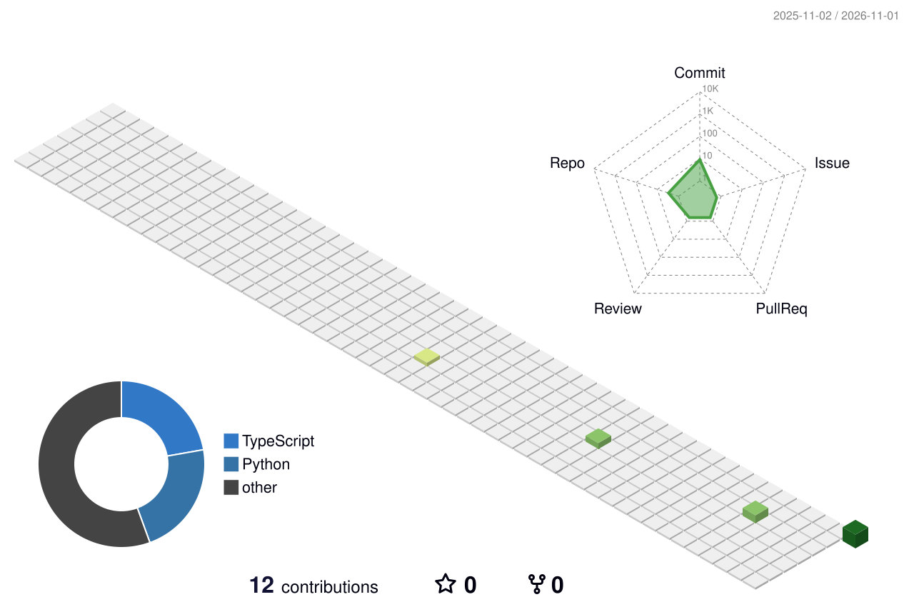

  

  
  

## `01 / THE BUILDER`

Hey, I'm **Priyadarshan S.** — a 2nd-year Computer Science & Engineering student at **Info Institute of Engineering**.

I enjoy working at the intersection of **software, AI, and design**: turning interesting problems into practical tools, thoughtful interfaces, and experiments worth sharing.

- 🧠 Exploring **AI/ML** and intelligent applications
- 🌐 Building my skills in **full-stack development**
- 🎮 Interested in **game design** and interactive experiences
- 🎨 Care about **UI/UX**, not just whether the code runs
- 🛠️ Learning by building, shipping, and iterating

> **Developer by logic. Designer by imagination.**

## `02 / TECH STACK`

  

| Focus | Currently exploring |
|---|---|
| Languages | Python · Java · C · JavaScript |
| Web | HTML · CSS · React |
| Workflow | Git · GitHub · VS Code |
| Interests | AI/ML · Full-stack · UI/UX · Game development |

## `03 / PROJECTS THAT DESERVE A LOOK`

I want my repositories to show more than code: **the problem, the decisions, and what I learned**.

<!-- Replace these three cards with real repository links and one-line outcomes as you publish projects. -->
<table>
  <tr>
    <td width="50%">
      <h3>🚧 Project spotlight 01</h3>
      <b>Your strongest completed project</b> 
      jarvis my personal assistant .  
      <a href="https://github.com/priyadarshan0507?tab=repositories">Browse repositories →</a>
    </td>
    <td width="50%">
      <h3>🧪 Project spotlight 02</h3>
      <b>Your most interesting experiment</b> 
      Highlight an AI, automation, or full-stack project with a demo or screenshot.  
      <a href="https://github.com/priyadarshan0507?tab=repositories">Browse repositories →</a>
    </td>
  </tr>
</table>

## `04 / BUILD LOG — IDEAS I'M EXCITED ABOUT`

Here are project concepts I’d like to turn into real, documented repositories. These are **ideas / planned builds**, not claimed completed projects.

| Project | What makes it interesting | Suggested stack |
|---|---|---|
| **CampusPulse** | Campus event, club, and announcement hub with personalized reminders | React · Node.js · PostgreSQL |
| **RepoRadar** | A dashboard that explains repository activity, issues, and contribution patterns | React · GitHub API · Python |
| **StudyForge AI** | Turn notes into summaries, flashcards, and self-tests with source-aware answers | Python · FastAPI · LLM API |
| **SkillSwap** | Students teach each other skills through listings, matching, and session scheduling | React · Firebase |
| **BugLens** | Paste an error log and get structured debugging hypotheses, fixes, and learning notes | Python · FastAPI · LLM API |
| **PixelQuest** | A small browser game with levels, achievements, and a polished UI | JavaScript · Canvas |

**My build rule:** ship a small working version first, write a clear README, add screenshots, then improve it from feedback.

## `05 / GITHUB SIGNAL`

  
  
  

### `// CONTRIBUTION GRAPH`

## `06 / HOW I BUILD`

`IDEA → RESEARCH → PROTOTYPE → BUILD → TEST → DOCUMENT → SHIP`

I value readable code, useful documentation, thoughtful interfaces, and projects that solve a real problem—even if the first version is small.

## `07 / LET'S CONNECT`

Have an idea, collaboration, or feedback on one of my projects? **I'd love to hear from you.**

  
  <!-- Add your LinkedIn and portfolio links here when you have the URLs. -->

**IMAGINE. BUILD. SHARE. REPEAT.**

